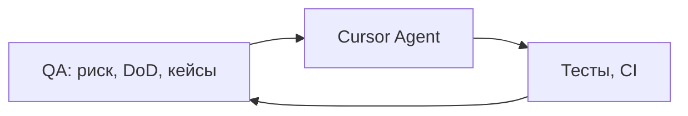

# Карта курса — Cursor Harness (QA → Automation)

Курс на **~8 недель** плотного темпа. Ты остаёшься QA-мозгом: ставишь задачи, принимаешь артефакты, гоняешь проверки. Cursor и харнес делают черновую работу.

---

## Главная идея



- **QA** — что проверять, как приоритизировать, когда сказать Rework  
- **AI** — шаблоны, код, тесты по твоему ТЗ  
- **AQA** — повторяемый прогон (Vitest, XCTest, GitHub Actions)

К концу курса большая часть **тела** артефактов генерируется AI; твоя ценность — **заказ, приёмка, оркестрация**.

---

## Домашка: HAND / AI / MIX

В каждом уроке в таблице указано, что делать самому, что поручать Agent.

| Метка | Смысл |
|-------|--------|
| **HAND** | Только ты (теория, выводы, git, smoke) |
| **AI** | Agent создаёт артефакт; ты принимаешь по DoD |
| **MIX** | Ты — бриф и промпт; AI — содержимое; ты — diff |

---

## GitHub

Задания — в template curriculum. Ответы — **только в workbook студента**.

→ [STUDENT.md](STUDENT.md) · [docs/github-workflow.md](docs/github-workflow.md)

---

## Харнес

| Слой | Где | Зачем |
|------|-----|--------|
| **Student** | **`student/`** | Твои rules/skills — portable |
| Teacher | `teacher/` | Проверка ДЗ, scaffold-ТЗ |
| Author | `author/` | Maintainer curriculum |
| Entrypoint | `.cursor/` | Stub + router (не харнес) |

→ [docs/cursor-layout.md](docs/cursor-layout.md)

**Scaffold skills** (болванки приложений): [teacher/skills/scaffold-apps/README.md](teacher/skills/scaffold-apps/README.md)

---

## Программа по неделям

| # | Тема | Приложение | Статус |
|---|------|------------|--------|
| 1 | Cursor + основы QA | артефакты на бумаге | ✅ [weeks/01](weeks/01) |
| 2 | Web + unit + CI + e2e smoke | Tip Calculator | ✅ [weeks/02](weeks/02) |
| 3 | Web e2e, POM | Tip Calculator | план |
| 4 | Android | Water Tracker | план |
| 5 | iOS | Countdown List | план |
| 6 | Rules, skills, memory | харнес v1 | план |
| 7 | Black-box + Appium | Yango Motors | план |
| 8 | MCP, multi-agent | Bug Tracker | план |

**План модулей 3–8 (maintainer):** [author/ROADMAP.md](author/ROADMAP.md)

---

## Модуль 1 — что внутри

Четыре урока + checkpoint:

1. DoD и язык заказа агенту  
2. Chat / Agent / diff / Reject  
3. STLC и lifecycle бага  
4. Типы тестов, EP/BVA, сьюты  

→ [weeks/01/README.md](weeks/01/README.md)

---

## Модуль 2 — что внутри

Четыре урока + checkpoint:

1. Scaffold Tip Calculator (React + TS) + Git в workbook  
2. Unit-тесты (Vitest) + трассировка к требованиям  
3. GitHub Actions + первый `student/rules/web-testing.mdc`  
4. Playwright smoke + skill `run-and-fix`  

→ [weeks/02/README.md](weeks/02/README.md)

---

## Проверка

```text
проверь домашку недели N, урок M
проверь checkpoint недели N
```

Teacher: `teacher/rules/teacher.mdc`, skill `grade-homework`.

---

## С чего начать прямо сейчас

Новый студент: [STUDENT.md](STUDENT.md) → [Неделя 1](weeks/01/README.md)  
Прошёл модуль 1: [Неделя 2](weeks/02/README.md)
