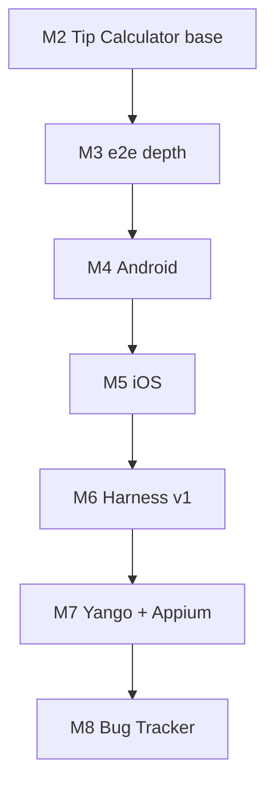

# Roadmap — модули 3–8

Живой план автора curriculum. Студентам **не обязательно** читать — это памятка «что дописать дальше».

**Готово:** модули [1](../weeks/01/README.md) ✅ · [2](../weeks/02/README.md) ✅

**Шаблон модуля:** 4 урока + `CHECKPOINT.md` + rubrics + submission templates + `weeks/NN/README.md` (+ spec и scaffold skill, если новое приложение).

---

## Сводка

| # | Фокус | Приложение | Scaffold | Student harness (новое) |
|---|--------|------------|----------|-------------------------|
| 3 | Web e2e в глубину | Tip Calculator (тот же) | фазы `+pom`, `+regression` в существующем skill | rule/skill про POM и flake |
| 4 | Android нативные тесты | Water Tracker | `scaffold-android-water-tracker` ✅ | `student/rules/android-testing.mdc` |
| 5 | iOS нативные тесты | Countdown List | `scaffold-ios-countdown-list` ✅ | `student/rules/ios-testing.mdc` |
| 6 | Харнес v1 (мета) | все прошлые apps | — | inventory, memory-bank, матрица примитивов |
| 7 | Black-box + Appium | Yango Motors + один учебный app | нет (внешний URL) | skill black-box / appium-smoke |
| 8 | Выпускной | Bug Tracker | `scaffold-bug-tracker` ✅ | MCP, multi-agent, graduation checkpoint |



---

## Модуль 3 — Web: e2e, POM, regression

**Цель:** не новое приложение — **углубить** автоматизацию на `projects/web-tip-calculator/`. Студент учится структурировать e2e, ловить flake, собирать regression.

**Зависимости:** модуль 2 (smoke e2e + CI + `run-and-fix`).

### Уроки (черновик)

| # | Тема | HAND | AI/MIX | Артефакт в workbook |
|---|------|------|--------|------------------------|
| 3.1 | **POM / fixtures** — вынести селекторы и шаги | smoke на refactored tests | структура `e2e/pages/`, `e2e/fixtures/` | Playwright POM, зелёный smoke |
| 3.2 | **Regression pack** — расширить покрытие по `tip-suites` | таблица case → spec | 3–5 новых e2e или tagged `@regression` | regression suite, traceability |
| 3.3 | **Flake & debug** — trace, screenshot, retry policy | break-fix на намеренном flake | обновить `run-and-fix` под e2e artifacts | skill v2, doc «когда retry ok» |
| 3.4 | **CI reporting** — junit artifact, optional shard | интерпретация failed run | workflow: upload report, fail on regression | обновлённый workflow |

### Checkpoint 3

- Инвентарь: POM tree, ≥N regression tests, CI artifacts, обновлённый skill.
- Квиз: POM vs inline; flake vs bug; smoke vs regression.
- Связь с модулем 1: decision table или state transition для одного сценария tip (опционально в 3.2).

### Author TODO

- [ ] `weeks/03/` — lessons, rubrics, templates, README, CHECKPOINT
- [ ] Расширить `teacher/skills/scaffold-web-tip-calculator/SKILL.md` — фазы `+pom`, `+regression` (DoD)
- [ ] Spec appendix в `weeks/02/spec/tip-calculator.md` или `weeks/03/spec/e2e-scope.md`
- [ ] Обновить `COURSE.md`, `STUDENT.md` после публикации

**Открытые решения:** один большой regression file vs tagged tests; playwright report в GHA (storage limits).

---

## Модуль 4 — Android: Water Tracker

**Цель:** первый **мобильный нативный** стек: Kotlin, Compose, JUnit, Compose UI test, CI (или documented local gate).

**Scaffold:** [scaffold-android-water-tracker](../teacher/skills/scaffold-android-water-tracker/SKILL.md) — уже есть.

### Уроки (черновик)

| # | Тема | HAND | AI/MIX | Артефакт |
|---|------|------|--------|----------|
| 4.1 | **Scaffold + emulator smoke** | Android Studio run, quick-add руками | проект в `projects/android-water-tracker/` | README smoke, git |
| 4.2 | **Unit на domain** | EP/BVA для addWater, goal bounds | JUnit tests `WaterTrackerState` | ≥6 unit, green |
| 4.3 | **Compose UI smoke + CI** | эмулятор/устройство smoke | UI test: quick add виден в progress | Gradle test task; GHA или «CI optional» |
| 4.4 | **Rule android-testing** | сравнение с web-testing | `student/rules/android-testing.mdc` | rule + skill reuse run-and-fix |

### Checkpoint 4

- App + unit + ≥1 UI test; rule; таблица «web vs android test pyramid».

### Author TODO

- [ ] `weeks/04/spec/water-tracker.md` (вынести из skill — single source)
- [ ] `weeks/04/` полный модуль
- [ ] Решить CI: `ubuntu + emulator` vs «local required + GHA lint only» (реалистичность для студентов)
- [ ] `projects/README.md` — spec link

**Открытые решения:** min SDK; in-memory vs DataStore (MVP — in-memory/viewmodel); confirm dialog на Reset.

---

## Модуль 5 — iOS: Countdown List

**Цель:** Swift/SwiftUI, XCTest на `daysUntil`, XCUITest add event, паттерн как Android но Xcode toolchain.

**Scaffold:** [scaffold-ios-countdown-list](../teacher/skills/scaffold-ios-countdown-list/SKILL.md) — уже есть.

### Уроки (черновик)

| # | Тема | HAND | AI/MIX | Артефакт |
|---|------|------|--------|----------|
| 5.1 | **Scaffold + simulator smoke** | add event, sort check | Xcode project | git + smoke notes |
| 5.2 | **XCTest unit** | BVA dates: today, past, future | tests on `daysUntil` | unit green |
| 5.3 | **XCUITest smoke** | accessibility ids policy | one flow: add → list shows N days | UI test |
| 5.4 | **Rule ios-testing + parity** | таблица Android/iOS tooling | `student/rules/ios-testing.mdc` | rule |

### Checkpoint 5

- Три платформы в workbook: web + android + ios (инвентарь путей).
- Квиз: XCTest vs XCUITest; почему нет Playwright на iOS native.

### Author TODO

- [ ] `weeks/05/spec/countdown-list.md`
- [ ] `weeks/05/` полный модуль
- [ ] CI: `macos-latest` + `xcodebuild test` или local-only с rubric «лог xcodebuild»
- [ ] Обновить scaffold skill min iOS version единообразно

**Открытые решения:** in-memory vs SwiftData (MVP — ObservableObject/array); секция Past events.

---

## Модуль 6 — Harness v1 (мета-модуль)

**Цель:** осознанно собрать **student harness** — не новое учебное app. Cursor-примитивы: rules, skills, (опционально) hooks, memory, subagents.

**Зависимости:** модули 2–5 дали rules/skills по платформам.

### Уроки (черновик)

| # | Тема | HAND | AI/MIX | Артефакт |
|---|------|------|--------|----------|
| 6.1 | **Матрица примитивов** | rule vs skill vs MCP vs hook — когда что | диаграмма + `student/README.md` v2 | таблица в submission |
| 6.2 | **Авторинг skill** | progressive disclosure, DoD skill | новый skill: `test-design-helper` или `bug-report-helper` | `student/skills/.../SKILL.md` |
| 6.3 | **Memory / project context** | что класть в memory-bank | структура `student/memory-bank/` или `docs/project-context.md` | 3 файла контекста |
| 6.4 | **Export & hygiene** | что в repo vs `~/.cursor/skills` | `.cursorignore`, cost/context notes | export plan + `.cursorignore` |

### Checkpoint 6

- Harness inventory: все rules/skills, 1 новый skill своей авторства.
- Квиз: Teacher vs Student layer; COURSE_ONLY.
- Связь: [docs/cursor-layout.md](../docs/cursor-layout.md), [docs/prompting.md](../docs/prompting.md) refresh.

### Author TODO

- [ ] `weeks/06/` — без spec приложения; practice-only
- [ ] Примеры **не** копировать teacher skills в student
- [ ] Опционально: `author/skills/publish-week/` для maintainer
- [ ] Решить: hooks в программе или «bonus appendix»

**Открытые решения:** обязателен ли subagents в 6.4 или перенести в модуль 8; memory-bank формат (cursor official vs свой).

---

## Модуль 7 — Black-box: Yango Motors + Appium

**Цель:** тестировать **чужой** продукт без исходников; затем один **Appium** сценарий на уже собранный Water Tracker или Countdown (не третье приложение).

**Приложение black-box:** [Yango Motors](https://motors.yango.com/) (Playwright, только публичные сценарии).

### Уроки (черновик)

| # | Тема | HAND | AI/MIX | Артефакт |
|---|------|------|--------|----------|
| 7.1 | **Charter + test plan** | exploratory charter 90 min | test plan doc в `weeks/07/practice/yango-plan.md` | plan + 5+ cases |
| 7.2 | **Playwright black-box** | этика, стабильные селекторы, no auth abuse | smoke spec отдельная папка `practice/yango-e2e/` | 2–3 automated checks (или documented blockers) |
| 7.3 | **Appium setup** | emulator + inspector smoke | один сценарий: open app → assert element | Kotlin test в android или ios проекте |
| 7.4 | **Native vs Appium** | таблица когда Appium, когда нет | обновить platform rule footnote | comparison + skill stub `appium-smoke` |

### Checkpoint 7

- Yango plan + хотя бы 1 automated или обоснованный blocker.
- Appium (или Espresso/XCUITest fallback если Appium env недоступен — зафиксировать в rubric).
- Bug report по найденному на Yango (шаблон `templates/bug-report.md`).

### Author TODO

- [ ] `weeks/07/spec/yango-scope.md` — **in scope / out of scope** (no scraping, no load)
- [ ] `weeks/07/practice/README.md`
- [ ] Rubric: flaky external site ≠ student fail if documented
- [ ] Appium: Gradle/Maven skeleton или ссылка на минимальный шаблон в teacher (не full scaffold app)

**Открытые решения:** Yango locale (en/ru); Appium на Android only vs iOS; headless Playwright vs headed in CI.

---

## Модуль 8 — Выпускной: Bug Tracker + MCP / multi-agent

**Цель:** graduation project — **Bug Tracker** web, полная петля QA→AI→AQA, интеграция MCP (опционально browser/jira stub), multi-agent workflow.

**Scaffold:** [scaffold-bug-tracker](../teacher/skills/scaffold-bug-tracker/SKILL.md) — уже есть.

### Уроки (черновик)

| # | Тема | HAND | AI/MIX | Артефакт |
|---|------|------|--------|----------|
| 8.1 | **Scaffold + acceptance** | приёмка по spec B1–B6 | `projects/bug-tracker-web/` | smoke + localStorage |
| 8.2 | **Unit + e2e на bugs.ts** | traceability status workflow | Vitest + Playwright create→filter | tests + CI |
| 8.3 | **MCP или tool use** | один MCP server (browser, filesystem, custom) | doc + config `.cursor/mcp.json` example | рабочий сценарий «agent + tool» |
| 8.4 | **Multi-agent / graduation** | stage gates: QA agent → fix agent | README graduation + demo script | video/script + final harness export |

### Checkpoint 8 (graduation)

- Bug Tracker: B1–B6, tests green, CI.
- Portfolio table: все `projects/*`, все student rules/skills.
- Essay HAND: что автоматизируешь первым на работе.
- Optional: mobile slice bug tracker — **out of scope** unless stretch rubric.

### Author TODO

- [ ] `weeks/08/spec/bug-tracker.md` (из skill)
- [ ] `weeks/08/` полный модуль
- [ ] Graduation rubric stricter than usual modules
- [ ] `COURSE.md` — статус «курс complete»
- [ ] Template repo release notes / STUDENT «после курса»

**Открытые решения:** MCP как обязательный или optional Pass with notes; backend mock vs localStorage only (skill уже localStorage).

---

## Сквозная ось (все модули 3–8)

| Тема | Где повторяется |
|------|-----------------|
| HAND / AI / MIX | каждый урок |
| Traceability case → test | 3, 4, 5, 8 |
| CI as feedback for AI | 3, 4, 5, 8 |
| `student/rules` рост | 3 (e2e), 4 android, 5 ios |
| `student/skills` рост | 3 run-and-fix v2, 6 новый, 7 appium, 8 graduation |
| Teacher `grade-homework` | без изменений — пути `weeks/WW/rubrics/` |
| Spec ↔ scaffold sync | при каждом новом app |

---

## Чеклист публикации модуля (копипаста)

```text
[ ] weeks/NN/README.md
[ ] weeks/NN/lessons/01..04-*.md
[ ] weeks/NN/CHECKPOINT.md
[ ] weeks/NN/rubrics/lesson-01..04.md + checkpoint.md
[ ] weeks/NN/submissions/*.template.md
[ ] weeks/NN/spec/*.md (если app)
[ ] scaffold skill фазы согласованы с уроками
[ ] projects/README.md + teacher/scaffold-apps/README.md
[ ] COURSE.md + README.md статус
[ ] STUDENT.md «куда идти после модуля N-1»
[ ] git commit + push main
```

---

## Порядок работы автора (рекомендуемый)

1. **М3** — быстрый win на том же repo, без нового scaffold  
2. **М4 + М5** — пара mobile (specs вынести из skills)  
3. **М6** — пока свежи правила, закрепить harness  
4. **М7** — зависит от стабильности Yango; можно черновик rubric заранее  
5. **М8** — финал, после всего harness  

**Оценка объёма:** ~1 модуль = как модуль 2 (4 урока + rubrics + templates) ≈ 4–8 часов автора; м7 и м8 могут быть длиннее из-за env/Appium/MCP.

---

## Связанные файлы

- [COURSE.md](../COURSE.md) — публичная карта  
- [teacher/skills/scaffold-apps/README.md](../teacher/skills/scaffold-apps/README.md)  
- [AUTHOR.md](../AUTHOR.md)  
- [docs/cursor-layout.md](../docs/cursor-layout.md)

_Обновлено: 2026-08-12 — после публикации модуля 2._
