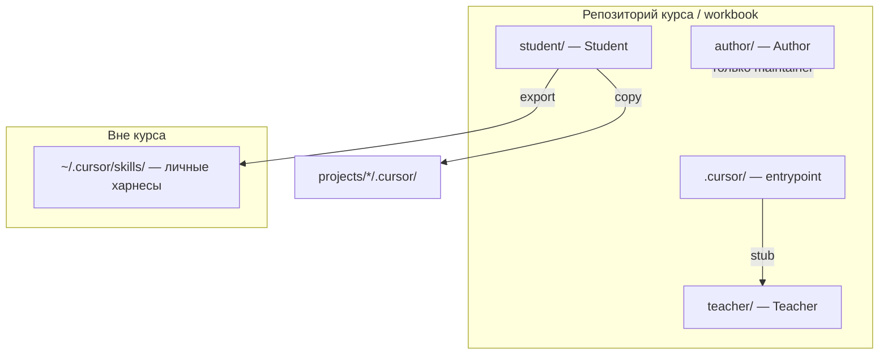

# Раскладка харнесов — три роли + личные наборы вне курса

Cursor «из коробки» подхватывает только [`.cursor/`](../.cursor/README.md) в корне открытого workspace. Поэтому мы **не** кладём три харнеса в одну папку — разводим по смыслу и явно описываем, что куда копировать.



---

## Четыре слоя (запомни таблицу)

| Слой | Папка | Кто | Portable? | Зачем |
|------|-------|-----|-----------|-------|
| **Entrypoint** | `.cursor/` | Курс | Нет | Stub'ы и router, чтобы Cursor нашёл Teacher |
| **Teacher** | `teacher/` | Курс | Нет | Проверка ДЗ, scaffold-ТЗ приложений |
| **Student** | `student/` | Ученик | **Да** | Rules/skills, которые ты строишь на курсе |
| **Author** | `author/` | Автор curriculum | Нет | Правка уроков, rubrics, публикация — не для учеников |

**Workbook студента** = template + `student/` (растёт) + `projects/` + submissions.  
**Curriculum автора** = то же + правки в `weeks/`, `author/`.

---

## 1. Entrypoint — `.cursor/` (не «весь харнес»)

Только то, без чего Cursor не свяжет курс с Teacher:

| Файл | Роль |
|------|------|
| `rules/course-workspace.mdc` | Роутинг: Teacher / Student / Author |
| `skills/grade-homework/` | stub → `teacher/skills/grade-homework` |
| `skills/scaffold-*/` | stub → `teacher/skills/scaffold-*` |
| `COURSE_ONLY.md` | Список «не экспортировать» |

**Сюда не кладём** учебные `write-e2e`, `bug-to-test` — они живут в `student/`.

Подробнее: [`.cursor/README.md`](../.cursor/README.md).

---

## 2. Teacher — `teacher/`

Виртуальный преподаватель и **готовые ТЗ болванок** приложений.

| Содержимое | Примеры |
|------------|---------|
| rules | `teacher.mdc` |
| skills | `grade-homework`, `scaffold-web-tip-calculator`, … |

- Есть в workbook **намеренно** — чтобы `проверь домашку` работала offline.  
- **Не копируешь** в рабочие проекты и не смешиваешь со `student/`.  
- Каталог scaffold: [teacher/skills/scaffold-apps/README.md](../teacher/skills/scaffold-apps/README.md).

---

## 3. Student — `student/` (твой portable-харнес курса)

Сюда по урокам складывается **твой** QA/AQA-харнес:

```text
student/
  README.md
  rules/          # qa-standards.mdc, web-testing.mdc, …
  skills/         # write-unit-tests, run-and-fix, …
  agents/         # позже
  memory-bank/    # позже
```

### Как Cursor это видит

Папка `student/` **не** подхватывается автоматически. Три рабочих паттерна:

| Паттерн | Когда |
|---------|--------|
| **`@student/skills/...`** в чате | Достаточно для большинства уроков |
| **Копия в `.cursor/`** | Если нужен auto-discovery skill по имени |
| **Копия в `projects/foo/.cursor/`** | Работа над одним приложением изолированно |

### Экспорт после курса

```bash
# перенести в личный харнес (все проекты)
cp -R student/skills/* ~/.cursor/skills/
cp -R student/rules/*  ~/.cursor/rules/   # если используешь project-style rules локально
```

Или отдельный git-репо `my-qa-harness/` — клонируешь и копируешь в нужный проект.

---

## 4. Author — `author/` (только maintainer)

Для **автора** curriculum (`lordsxrom/ai-course`): правка недель, rubrics, push в GitHub.

```text
author/
  README.md
  rules/
  skills/       # publish-week, lint-rubric, … — по мере надобности
```

**Студентам:** папка в template может приехать пустой — **не использовать**, не класть туда ДЗ.  
См. [author/README.md](../author/README.md).

Author ≠ Teacher: Author пишет курс; Teacher проверяет ученика.

---

## Личные харнесы вне этого курса

Курс — один из нескольких контекстов (работа, pet-project, другой стек).

| Задача | Куда (рекомендация Cursor) |
|--------|----------------------------|
| Универсальный QA-харнес на все проекты | `~/.cursor/skills/<name>/` |
| Харнес команды / проекта | `<repo>/.cursor/skills/` |
| Харнес с курса QA→Automation | `student/` → export в `~/.cursor/` |
| Проверка ДЗ / scaffold курса | `teacher/` (не export) |

Именуй по домену: `~/.cursor/skills/work-e2e/`, `~/.cursor/skills/course-qa/` — не смешивай в одной куче без префикса.

---

## Матрица «куда положить новый файл»

| Ты хочешь… | Путь |
|------------|------|
| Skill проверки домашки | `teacher/skills/` + stub `.cursor/skills/` |
| Skill scaffold приложения | `teacher/skills/scaffold-*/` + stub |
| Skill «пиши e2e по стандарту QA» | `student/skills/` |
| Rule «DoD = зелёный CI» | `student/rules/` |
| Skill «сверстай неделю 3» | `author/skills/` |
| Router «не путай Teacher и Student» | `.cursor/rules/course-workspace.mdc` |
| Домашка, кейсы, код app | `weeks/`, `templates/`, `projects/` — **не харнес** |

---

## Workbook vs curriculum

| Артефакт | Curriculum (GitHub автора) | Workbook (GitHub студента) |
|----------|----------------------------|----------------------------|
| `weeks/`, `teacher/` | ✅ | ✅ (копия template) |
| `author/` | ✅ (author ведёт) | ⚠️ игнорировать |
| `student/` | пустой README | ✅ растёт |
| submissions, projects | ❌ | ✅ |

→ [github-workflow.md](github-workflow.md)

---

## Папка `harness/` удалена

Раньше планировали `harness/` — дублировала `student/` и путала. Актуальная схема только в этом файле.
