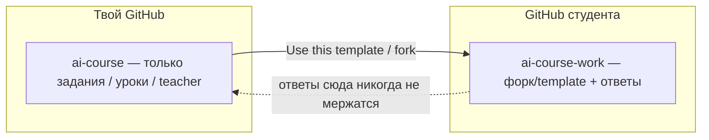

# GitHub: задания у автора, ответы у студента



## Два репозитория — два смысла

| Репо | Кто владеет | Что внутри | Чего нет |
|------|-------------|------------|----------|
| **Curriculum** (твой) | Ты | уроки, rubrics, templates, `teacher/`, скелет `.cursor` COURSE_ONLY | заполненные сдачи, practice студента, его apps |
| **Workbook** (студента) | Студент | копия курса **+** его ответы, practice, `projects/`, растущий `.cursor` | права пушить в твой curriculum |

Проверка Teacher (`проверь домашку…`) идёт **локально в workbook-репо студента**. Тебе не нужно забирать их файлы в свой GitHub, чтобы скилл отработал.  
Если захочешь ревьюить глазами — студент даёт ссылку на **свой** репо / PR у себя.

## Как публикуешь ты (автор)

1. Этот каталог = **curriculum**.  
2. В GitHub: создать репо (например `ai-course`), запушить.  
3. Сделай template: `gh repo edit --template` (или Settings → **Template repository** = On) — студентам удобнее «Use this template», чем классический fork (меньше путаницы с PR «назад»).  
4. Не коммить студенческие ответы. Защита: [`.gitignore`](../.gitignore) + дисциплина.  
5. Обновления курса = коммиты только в curriculum; студенты подтягивают отдельно (см. ниже).

Чеклист «можно пушить upstream»:

- [ ] Нет `weeks/*/submissions/lesson-*.md` (только `*.template.md`)  
- [ ] Нет `weeks/*/submissions/checkpoint.md`  
- [ ] Нет личного содержимого в `weeks/*/practice/` (кроме README)  
- [ ] Нет `projects/*` с чужим/своим учебным кодом как «ответом потока» (в curriculum — только README-заглушка)  
- [ ] Secrets / `.env` нет  

## Как стартует студент

См. короткий гайд: [`STUDENT.md`](../STUDENT.md).

Кратко:

1. На GitHub curriculum → **Use this template** → репо под своим аккаунтом (`my-ai-course` и т.п.).  
2. Clone **своего** репо в Cursor.  
3. Делает ДЗ, коммитит, пушит к себе.  
4. В чат: `проверь домашку недели N, урок M`.  

**Не** делать homework в clone твоего curriculum с push upstream.

## Что считается «заданием», что — «ответом»

| Задание (в curriculum, публично) | Ответ (только workbook студента) |
|----------------------------------|----------------------------------|
| `weeks/**/lessons/` | — |
| `weeks/**/rubrics/` | — |
| `weeks/**/submissions/*.template.md` | `weeks/**/submissions/lesson-*.md`, `checkpoint.md` |
| `weeks/**/CHECKPOINT.md`, README | `weeks/**/practice/**` (артефакты) |
| `templates/` (канон/скелет) | правки шаблонов под себя, filled examples в practice |
| `teacher/`, docs курса | — |
| `.cursor` COURSE_ONLY stub | **`student/`** + `projects/` |

## Обновления курса у студента

Чтобы подтянуть новые уроки из curriculum (модули 2, 3, …), добавь remote на репозиторий автора:

```bash
git remote add upstream git@github.com:lordsxrom/ai-course.git
git fetch upstream
git merge upstream/main   # или rebase — осторожно с конфликтами в submissions/
```

Правило: конфликты в `submissions/` и `practice/` студент решает в пользу **своих** ответов; уроки/rubrics — в пользу upstream.

Если курс только что скопирован из template и upstream не нужен — достаточно одного clone. Remote имеет смысл, когда автор выкладывает обновления, а у тебя уже есть свои сдачи.

## Fork vs Template

| | Template (рекомендуем) | Fork |
|---|------------------------|------|
| Отдельное репо у студента | Да | Да (fork) |
| Случайный PR с ответами в твой репо | Реже | Чаще соблазн |
| «Contribute to course» | Через отдельный PR только docs/lessons | Путают с ДЗ |

Исключение: студент хочет починить опечатку в уроке — PR **только** по файлам заданий, без `submissions/`.

## GitHub Classroom (опционально позже)

Если появится поток студентов — Classroom раздаст private workbook-репо из template автоматически. Модель та же: ответы не в curriculum.

## Связь с Teacher / `.cursor`

- Логика препода в curriculum: `teacher/` + COURSE_ONLY stub.  
- Уезжает студенту вместе с template — чтобы самопроверка работала offline.  
- Portable skills студента копятся в **`student/`** и пушатся в **его** GitHub — это его харнес, не curriculum.
