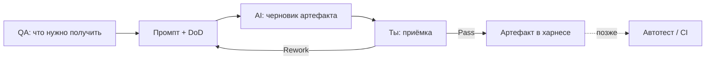
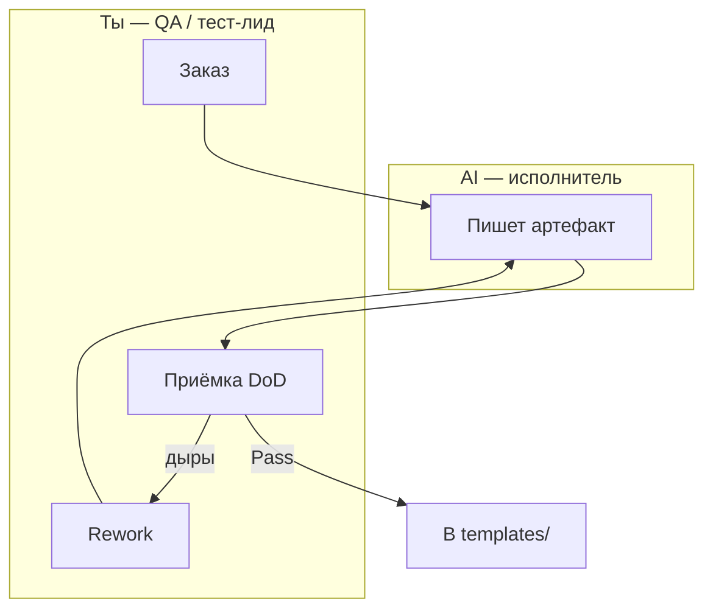

# Урок 1.1 — Заказ артефакта: промпт как ТЗ и DoD как приёмка

| | |
|---|---|
| **Неделя** | 1 |
| **Время** | 45–70 минут |
| **Сдача** | `weeks/01/submissions/lesson-01.md` |
| **Проверка** | `проверь домашку недели 1, урок 1` |
| **Cursor сегодня** | Agent выполняет заказ; ты принимаешь по DoD |
| **К концу курса** | Такие заказы станут skills/rules; артефакты — почти без ручного набора |

---

## Одна картина: QA + AI + будущий AQA

Ты уже умеешь (или учишься) писать баг и кейс. В Cursor тот же навык называется иначе:

| В QA | В Cursor | Потом в AQA |
|------|----------|-------------|
| ТЗ / что проверить | Цель + контекст в промпте | Что попадёт в автотест |
| Ожидаемый результат | Пункты DoD | Assert / зелёный CI |
| Remains open / retest | Rework агенту | Падающий тест → фикс → retest |
| Accept build | Accept diff | Merge при зелёном пайплайне |



Если DoD слабый, AI выдаст «красивый шум» — ровно как подрядчик без критериев приёмки. AQA потом просто закрепит этот шум в CI.

---

## Каркас заказа (5 блоков)

Это не «магия промптов». Это тот же каркас, что у нормального запроса в тест / на фичу.

| Блок | QA-смысл | Пример |
|------|----------|--------|
| **Цель** | Что должно появиться | Шаблон тест-кейса |
| **Контекст** | Проект, роль, ограничения среды | Репо курса, я QA |
| **Артефакты** | Какие файлы/поля | `templates/test-case.md` |
| **Ограничения** | Out of scope | Не трогать другие недели |
| **DoD** | Критерии приёмки | 5 проверяемых пунктов |

> **DoD** — чеклист Pass/Rework за ≤30 секунд на пункт (файл есть / секция есть / команда зелёная).

| Плохо (не принять) | Хорошо (можно принять) |
|--------------------|------------------------|
| «Сделай нормально» | «Есть Steps и Expected» |
| «Покрой тестами» | «≥3 кейса: happy, boundary, negative» |
| «Чтобы работало» | `npm test` → exit 0 |

---

## Кто есть кто



Пока **не** обязан читать каждую строку кода. Обязан сказать: DoD выполнен или нет.  
Ближе к AQA-части курса DoD станет включать «тесты зелёные» — приёмка усложнится, роль та же.

---

## Пример: плохой vs нормальный заказ шаблона

**Плохо:** «Сделай шаблон для багов.»  
Нет пути, полей, примера, DoD → нечего принимать.

**Нормально:**

```text
Контекст: ai-course, я QA. Нужен шаблон баг-репорта как рабочий артефакт.

Сделай templates/bug-report.md
Секции: Title, Environment, Steps, Expected, Actual, Severity, Priority, Notes
Ограничения: только этот файл

DoD:
1. Файл по пути существует
2. Все секции на месте
3. Есть один заполненный пример (Tip Calculator)
4. Severity и Priority — по одной строке пояснения в шаблоне
```

Так ты уже тренируешь будущий skill `bug-report-from-fail`.

---

## Мини-практика (до ДЗ)

1. **AI:** плохим запросом попроси smoke-чеклист.  
2. **AI:** тем же смыслом через 5 блоков + DoD.  
3. **HAND:** сравни — где дыры как у плохого баг-репорта?

---

## Домашнее задание

Сдача: `weeks/01/submissions/lesson-01.md` (из template).

| Часть | Метка | Что делать |
|-------|-------|------------|
| **A** Теория | **HAND** | Ответы своими словами. Можно спросить Chat «объясни термин», нельзя «напиши мне ответы на A». |
| **B** Промпты | **HAND** | Плохой и хороший промпт на шаблон тест-кейса. Хороший: 5 блоков, **ровно 5** пунктов DoD. |
| **C** Артефакт | **AI** | Agent’ом по хорошему промпту из B создай `templates/test-case.md`. Руками набивать шаблон **нельзя** (правки после Reject/Rework — ок). |
| **C** Self-check | **HAND** | Таблица из 5 пунктов DoD: Pass/Fail + улика. |
| **D** Мета | **HAND** | Один абзац. |

В self-check обязательно строка: `artifact_via: agent`.

### Вопросы A (HAND)

1. Чем DoD отличается от «цели» заказа?  
2. Почему заказ AI похож на хороший баг-репорт / ТЗ на проверку?  
3. Что общего у «принял глазами без чеклиста» и «замержил без прогона»?

### Часть C — путь артефакта

`templates/test-case.md` должен закрывать твой DoD из B.

---

## DoD урока

Рубрика: [`../rubrics/lesson-01.md`](../rubrics/lesson-01.md)

1. Сдача A–D на месте; A и B = HAND-содержание  
2. Хороший промпт с ровно 5 DoD  
3. `templates/test-case.md` создан через Agent (`artifact_via: agent`)  
4. Self-check с уликами  
5. A не копипаста урока  

---

## Сдача

`проверь домашку недели 1, урок 1` → Rework только по дырам, снова через Agent, если нужно поправить артефакт.
