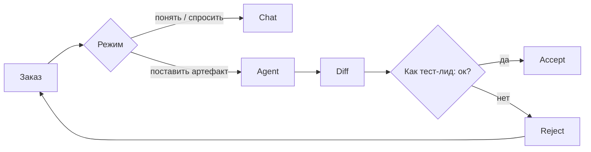

# Урок 1.2 — Приёмка «билда»: Chat, Agent, diff, Reject

| | |
|---|---|
| **Неделя** | 1 |
| **Время** | 50–80 минут |
| **Сдача** | `weeks/01/submissions/lesson-02.md` |
| **Проверка** | `проверь домашку недели 1, урок 2` |
| **Cursor сегодня** | режимы, `@`, diff, Accept/Reject |
| **К концу курса** | Тот же жест Accept станет «зелёный CI + ревью PR» |

---

## Одна картина

В ручном QA ты не принимаешь сборку словами «ну вроде открылось». Смотришь шаги, ожидаемое, Evidence.

В Cursor **diff** — это evidence по файлам. **Reject** — это «вернул с билда». **Accept** — ты поставил штамп на конкретный артефакт.

| QA / AQA | Cursor |
|----------|--------|
| Смотрим билд / PR | Смотрим diff |
| Не тот scope в поставке | Правки вне allowlist путей |
| Retest после фикса | Новый запрос + проверка файла снова |
| Неясный баг без окружения | Запрос без `@` и без пути |



Позже AQA добавит автоматический судью (CI). Сейчас судья — ты и Teacher-rubric.

---

## Карта репо (куда класть «поставку»)

Корень: `<корень твоего workbook>` (папка, открытая в Cursor)

| Путь | Смысл |
|------|--------|
| `weeks/01/lessons/` | материалы (не сдавать сюда) |
| `weeks/01/submissions/` | твоя сдача |
| `weeks/01/practice/` | учебные артефакты практики |
| `templates/` | рабочие шаблоны курса |
| `.cursor/` | **entrypoint** (stub), не student harness |
| `student/` | **твой** portable харнес |
| `teacher/` | препод |
| `author/` | maintainer — не трогать |
| `docs/cursor-layout.md` | раскладка четырёх слоёв харнеса |

Сдача урока N: `weeks/01/submissions/lesson-NN.md`.  
Заготовка: скопируй template → `lesson-02.md` (**AI** ниже сделает это за тебя по DoD).

---

## Chat vs Agent — как выбрать «инструмент прогона»

| Режим | Как ручной шаг | Когда |
|-------|----------------|-------|
| **Chat** | Спросить коллегу / уточнить ТЗ | разобрать урок, «что не так с DoD» |
| **Agent** | Отдать задачу на исполнение | создать/править файл в репо |

Если не уверен:

```text
Режим: Agent.
Только файл: weeks/01/submissions/lesson-02.md
Другие пути не трогать.
```

---

## Поставка через Agent + приёмка diff

1. Agent, запрос с путём и DoD.  
2. Открыть diff — это твой test evidence.  
3. Чеклист приёмки (как smoke по поставке):

| # | Проверка | Аналог в QA |
|---|----------|-------------|
| 1 | Путь = как в DoD | Собрали ту фичу? |
| 2 | Нет правок вне scope | Не притащили лишнее |
| 3 | Нужные секции/поля есть | Expected на месте |
| 4 | Не стёрли старое важное | Не просели regression |

4. Accept или Reject + rework-промпт.

### Запрос для копипаста (**AI**)

```text
Режим: Agent.
Скопируй weeks/01/submissions/lesson-02.template.md
→ weeks/01/submissions/lesson-02.md
Плейсхолдеры оставь. Template не меняй. Другие файлы не трогай.

DoD:
1. Существует lesson-02.md
2. Секции A–D как в template
3. template не изменён
```

---

## Контекст: `@` как «приложить environment к багу»

Модель не видит весь диск всегда. Без `@` и пути она фантазирует окружение — как баг без Environment.

| Нужно | Действие |
|-------|----------|
| Конкретный файл | `@путь` |
| Зона недели | `@weeks/01` (урок 1.3 закрепит) |
| Смена темы | Новый чат (не мешай evidence) |

Глубже про токены/окно — когда длинные сессии с кодом начнут врать. Модели: лёгкий разбор в уроке 1.4.

---

## Откаты

| Ситуация | Действие |
|----------|----------|
| Ещё превью | Reject |
| Уже Accept | Rework: «верни файл X» → снова diff |
| Совсем плохо + git | точечный откат файла (git глубже на CI-неделе) |

---

## Мини-практика (обязательна для части B)

1. **Chat HAND-наблюдение:** вопрос про секции сдачи 1.2 **без** `@`.  
2. **Chat:** то же с `@weeks/01/submissions/lesson-02.template.md`.  
3. **AI:** создай `lesson-02.md` запросом выше → diff → Accept только при верном пути.

---

## Домашнее задание

| Часть | Метка | Что делать |
|-------|-------|------------|
| **A** Теория | **HAND** | Три ответа (Chat vs Agent; зачем путь; чеклист diff×3). AI не пишет формулировки за тебя. |
| **B** Наблюдения | **HAND** | Таблица из мини-практики — только то, что реально увидел. |
| **C** Артефакт | **AI** | Agent создаёт `weeks/01/practice/cursor-controls.md` (см. ниже). |
| **D** Self-check + мета | **HAND** | Улики + абзац про UI. |

### Содержание C (**AI**)

Файл `weeks/01/practice/cursor-controls.md`:

- `# Cursor controls — урок 1.2`
- 5 буллетов: Chat / Agent / `@` / Diff / Reject — по фразе **«зачем мне это как QA при приёмке работы AI»**
- блок `## DoD check` со строками:
  - `path: weeks/01/practice/cursor-controls.md`
  - `bullets: 5`
  - `created_via: agent`

Allowlist: только этот файл (+ сдача, если ещё не создана). Не класть в `submissions/` и не трогать `lessons/`.

---

## DoD урока

[`../rubrics/lesson-02.md`](../rubrics/lesson-02.md) — плюс `created_via: agent` в артефакте.

---

## Сдача

`проверь домашку недели 1, урок 2`

---

## Отложено

Токены, сравнение моделей вглубь, git PR, CI как авто-приёмка.
