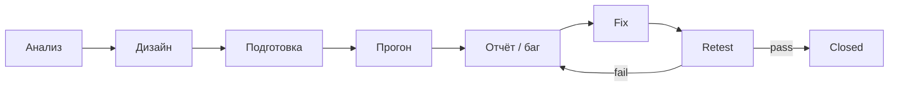
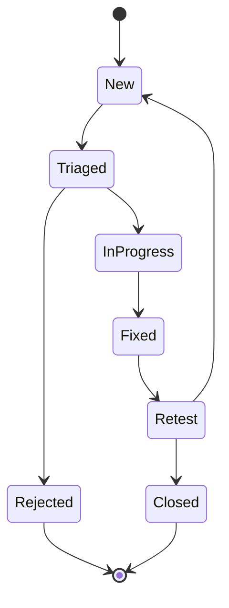

# Урок 1.3 — STLC и баг: процесс, в котором AI — только исполнитель шага

| | |
|---|---|
| **Неделя** | 1 |
| **Время** | 55–85 минут |
| **Сдача** | `weeks/01/submissions/lesson-03.md` |
| **Проверка** | `проверь домашку недели 1, урок 3` |
| **Cursor сегодня** | новый чат; `@` папка; allowlist путей |
| **К концу курса** | Баг → автотест → фикс пойдёт конвейером агентов; ты держишь стадии |

---

## Одна картина

AI любит прыгать сразу в «я пофиксил». QA-процесс запрещает этот прыжок: сначала понял риск и проверку, потом прогон, потом баг, потом fix, потом **retest**.

| Шаг STLC | Твоя роль | Роль AI сейчас | Потом AQA |
|----------|-----------|----------------|-----------|
| Анализ | риски, границы | может выписать риски по брифу | — |
| Дизайн | типы проверок, приоритет | черновик кейсов/сьютов | — |
| Подготовка | что нужно для прогона | тесты, моки, CI | пайплайн |
| Прогон | читать факты | гонять команды | CI отчёт |
| Отчёт | вердикт, баг | оформить репорт по шаблону | тикет + falling test |



**Правило курса:** пока нет артефакта текущего шага — нельзя заказывать AI следующий «как будто всё доказано».

---

## Жизненный цикл бага = контракт с исполнителем



| Статус | Смысл для тебя и AI |
|--------|---------------------|
| New | Есть репорт — ещё не решение |
| Fixed | Гипотеза исполнителя, **не** истина |
| Retest | Ты (или тесты) проверяешь Steps/Expected |
| Closed | Только после подтверждения |

> Agent написал «fixed» ≈ разработчик кинул билд. Без retest не Closed — ни в ручном QA, ни в AQA с зелёным билдом «у себя на машине».

### Severity vs Priority

| | Severity | Priority |
|---|----------|----------|
| Вопрос | Насколько больно продукту/юзеру? | Как быстро чинить? |
| AI-заказ | Попроси обосновать поле, не угадывать молча | То же |

---

## Cursor сегодня — hygiene процесса

1. **Новый чат на новую стадию/урок** — не смешивай evidence.  
2. **`@weeks/01` или `@templates`** — environment для заказа.  
3. **Allowlist** в каждом Agent-запросе:

```text
Разрешено:
- weeks/01/submissions/lesson-03.md
- templates/bug-report.md
- weeks/01/practice/stlc-mini.md
Иначе — не трогать.
```

Это тот же scope control, что «не тестируем весь продукт, только Share».

---

## Учебная фича (ещё без кода)

**Share в Tip Calculator:** в буфер  
`Total: $42.00 (incl. 10% tip)` + тост `Copied`.  
Прогон — воображаемый; важен процесс и артефакты.

---

## Домашнее задание

| Часть | Метка | Что делать |
|-------|-------|------------|
| **A** Теория | **HAND** | Дизайн vs прогон; Fixed≠Closed; пример severity≠priority. |
| **B** Таблица STLC в сдаче | **HAND** | 5 шагов: что делаешь + какой артефакт — **ты** раскладываешь процесс. |
| **B** `stlc-mini.md` | **MIX** | Ты даёшь бриф фичи Share (можно коротко в промпте). **Agent** пишет файл: Risks×3, Smoke×3, Imaginary run. Ты принимаешь: риски правдоподобны? smoke критичный? |
| **C** Шаблон + баг | **AI** | Agent создаёт `templates/bug-report.md` и один заполненный баг по Share (в сдаче или в `stlc-mini.md`). |
| **D** Self-check + мета | **HAND** | Улики; где хотелось прыгнуть в fix слишком рано. |

В артефактах: `created_via: agent` (для MIX/AI файлов).

### Пути

- `weeks/01/practice/stlc-mini.md` — `# STLC mini — Share tip` + Risks / Smoke suite / Imaginary run  
- `templates/bug-report.md` — Title, Environment, Steps, Expected, Actual, Severity, Priority, Notes + памятка sev/pri  

---

## DoD урока

[`../rubrics/lesson-03.md`](../rubrics/lesson-03.md)

---

## Сдача

`проверь домашку недели 1, урок 3`

---

## Отложено

EP/BVA глубже → 1.4; реальный CI-retest; GitHub Issues.
