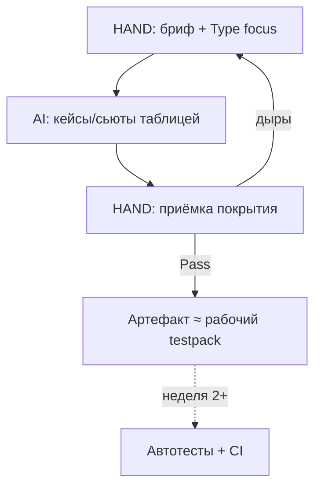

# Урок 1.4 — Типы покрытия: заказ сьютов у AI и приёмка как тест-дизайн

| | |
|---|---|
| **Неделя** | 1 |
| **Время** | 60–90 минут |
| **Сдача** | `weeks/01/submissions/lesson-04.md` |
| **Проверка** | `проверь домашку недели 1, урок 4` |
| **Cursor сегодня** | жёсткий формат таблицы; один переключатель модели |
| **К концу курса** | Сьюты/кейсы почти всегда генерятся харнесом; ты задаёшь риск и Type focus |

---

## Одна картина

Тип тестирования — это не ярлык «для отчёта». Это **язык заказа** для AI и **язык покрытия** для будущих автотестов.

| Тип | Вопрос QA | Как заказать AI | Как станет AQA |
|-----|-----------|-----------------|----------------|
| Smoke | Критичный путь жив? | «только smoke-share, 3 кейса» | job `smoke` в CI |
| Functional | ТЗ выполнено? | «по требованиям 1–N» | e2e happy-path |
| Negative | Кривой ввод обработан? | «невалид tip/split» | unit/UI negative |
| Boundary | Края диапазона? | «BVA для 0…30» | unit границ |
| Regression | Старое не отвалилось? | «не трогай total, добавь retest» | suite на каждый PR |
| Exploratory | Что упустили в дизайне? | «15 мин notes, не кейсы» | редко в авто |



Путаницы: smoke≠«чуть-чуть всего»; negative≠boundary; exploratory≠бесцельный клик (нужны цель, времябокс, notes).

---

## EP / BVA — чтобы заказ AI не был «напиши побольше кейсов»

**EP:** классы входов с одним поведением → по представителю.  
**BVA:** края и соседи.

Tip % ∈ **0…30** (целое):

| Класс | Пример | Тип |
|-------|--------|-----|
| < 0 | `-1` | negative |
| 0 | `0` | boundary |
| mid | `10` | functional |
| 30 | `30` | boundary |
| > 30 | `31` | negative |

Так ты проверяешь, что AI не накидал десять mid-значений и не назвал это coverage.

---

## Cursor сегодня

### Формат = контракт поставки

```text
Верни только Markdown-таблицу:
ID | Title | Type | Steps | Expected
Без вступлений. Suite = negative-boundary-tip.
Диапазон tip: 0..30. Нужны EP/BVA края.
```

Это зачаток того, что позже будет схемой в skill/MCP.

### Модель — один раз сравнить

Тот же вопрос «smoke vs regression + пример на Tip Calculator» двум моделям (если доступны).  
**HAND:** 2–4 предложения: что полезнее для заказа сьюта. Не бенчмарк ради бенчмарка.

---

## Объект

Tip Calculator: `bill > 0`, tip **0…30**, split **1…20**, Share как в 1.3. Кода ещё нет — пакет проверок бумажный, но уже «как для команды».

---

## Домашнее задание

| Часть | Метка | Что делать |
|-------|-------|------------|
| **A** Теория | **HAND** | smoke vs regression; negative vs boundary; зачем exploratory. |
| **B** Бриф | **HAND** | В сдаче короткий бриф (5–10 строк): фича, диапазоны, какие 2 сьюта заказываешь. |
| **B** Шаблоны + `tip-suites.md` | **AI** | Agent по брифу создаёт/обновляет `templates/test-case.md`, `templates/test-suite.md`, `weeks/01/practice/tip-suites.md`. Руками набивать кейсы **запрещено**. |
| **C** Промпт + модели | **MIX** | В сдачу вставь промпт с форматом таблицы (**HAND** написал). Заметка про модели (**HAND**). Генерация кейсов — тем же промптом через **AI**. |
| **D** Self-check + мета | **HAND** | Улики; какой тип даётся хуже. |

### Содержание `tip-suites.md` (принимай как тест-лид)

- трассировка ≥5: Requirement → Case ID → Suite  
- `smoke-share` — **ровно 3** кейса  
- `negative-boundary-tip` — **ровно 4** кейса с видимым EP/BVA  
- `## Exploratory notes` — времябокс 15 мин + 3 заметки  
- в конце: `created_via: agent`

Шаблоны: поля как в каноне курса (ID/Title/Type/… и Name/Goal/Case IDs/Entry/Exit). Если в репо уже есть черновики — Agent обновляет под бриф, не раздувая теорией.

---

## DoD урока

[`../rubrics/lesson-04.md`](../rubrics/lesson-04.md)

После Pass → [`../CHECKPOINT.md`](../CHECKPOINT.md).

---

## Сдача

`проверь домашку недели 1, урок 4`

---

## Дальше

Неделя 2: Tip Calculator на React — эти сьюты станут заказом на unit/e2e.  
Отложено: decision tables глубже; billing моделей; токены.
