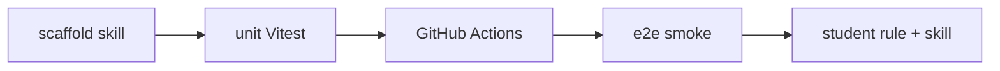

# Модуль 2 — Web: Tip Calculator

**Приложение:** калькулятор чаевых (React + TypeScript + Vite)  
**Результат модуля:** app + unit + CI + e2e smoke + первые файлы в **`student/`** harness.

Код — `projects/web-tip-calculator/` в **workbook**. Spec: [spec/tip-calculator.md](spec/tip-calculator.md).

---

## Программа

| # | Тема | Файл | Статус |
|---|------|------|--------|
| 1 | Scaffold + Git | [01-scaffold-and-git.md](lessons/01-scaffold-and-git.md) | ✅ |
| 2 | Unit (Vitest) | [02-unit-tests-vitest.md](lessons/02-unit-tests-vitest.md) | ✅ |
| 3 | GitHub Actions + rule | [03-github-actions-and-rule.md](lessons/03-github-actions-and-rule.md) | ✅ |
| 4 | Playwright + run-and-fix | [04-playwright-and-run-and-fix.md](lessons/04-playwright-and-run-and-fix.md) | ✅ |
| ✓ | **Checkpoint** | [CHECKPOINT.md](CHECKPOINT.md) | ✅ |

---

## Петля модуля



---

## Scaffold skill

```text
Используй skill scaffold-web-tip-calculator.
Фаза: scaffold | +tests | +ci
```

[teacher/skills/scaffold-web-tip-calculator/SKILL.md](../../teacher/skills/scaffold-web-tip-calculator/SKILL.md)

---

## Student harness после модуля

| Файл | Урок |
|------|------|
| `student/rules/web-testing.mdc` | 2.3 |
| `student/skills/run-and-fix/SKILL.md` | 2.4 |

Entrypoint `.cursor/` — не смешивай с `student/`. [docs/cursor-layout.md](../../docs/cursor-layout.md)

---

## Сдача

1. `submissions/lesson-NN.md` из template  
2. `git push` в свой repo  
3. `проверь домашку недели 2, урок N`  
4. После 2.4 → `проверь checkpoint недели 2`

---

## Дальше

Модуль 3 (план): Web e2e / POM на Tip Calculator — см. [author/ROADMAP.md](../../author/ROADMAP.md).

Не создан workbook? → [STUDENT.md](../../STUDENT.md)
