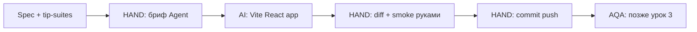

# Урок 2.1 — Tip Calculator: scaffold через Agent + Git в workbook

| | |
|---|---|
| **Неделя** | 2 |
| **Время** | 70–100 минут |
| **Сдача** | `weeks/02/submissions/lesson-01.md` |
| **Проверка** | `проверь домашку недели 2, урок 1` |
| **Cursor сегодня** | Agent + терминал; allowlist `projects/web-tip-calculator/` |
| **Spec** | [`../spec/tip-calculator.md`](../spec/tip-calculator.md) |

---

## Одна картина

Модуль 1 — QA-артефакты на бумаге. Неделя 2 — **тот же QA-мозг**, но артефакт = работающий код + коммит в **твоём** GitHub.



| Роль | Этот урок |
|------|-----------|
| QA | принять spec, smoke в браузере, зафиксировать баги, если есть |
| AI | scaffold проекта и UI по DoD |
| AQA | только `npm run dev` / позже тесты |

---

## Перед стартом

1. Workbook из template (`lordsxrom/ai-course` → Use this template).  
2. Модуль 1 желательно закрыт (checkpoint Pass) — не блокер, но `tip-suites` пригодится на 2.2.  
3. Node.js 18+ (`node -v`).

---

## Cursor сегодня

### Allowlist для Agent

```text
Разрешено создавать/менять только:
- projects/web-tip-calculator/**

Не трогать: weeks/, teacher/, .cursor/COURSE_ONLY stub, корневой COURSE.md
```

### Терминал

Agent может предложить `npm create vite@latest`. **Ты** смотришь вывод и принимаешь команды. После scaffold:

```bash
cd projects/web-tip-calculator
npm install
npm run dev
```

Smoke QA: открой localhost, введи bill=100, tip=10, split=1 — total должен быть 110.

### Git в workbook

Curriculum — не сюда. Каждый урок = commit у себя:

```bash
git status
git add projects/web-tip-calculator weeks/02/submissions/lesson-01.md
git commit -m "week2 lesson1: tip calculator scaffold"
git push
```

---

## Задание Agent (MIX — промпт HAND или skill)

**Рекомендуется:** skill с полным ТЗ (Teacher harness):

```text
Используй skill scaffold-web-tip-calculator.
Фаза: scaffold.
Создай projects/web-tip-calculator по DoD skill.
Allowlist: только projects/web-tip-calculator/
```

Skill: `teacher/skills/scaffold-web-tip-calculator/SKILL.md` (в Cursor подхватывается через `@scaffold-web-tip-calculator` или имя skill).

**Альтернатива — ручной промпт** (если тренируешь формулировки):

```text
Режим: Agent.

Контекст: курс ai-course, неделя 2. Spec: weeks/02/spec/tip-calculator.md (@ файл).

Создай projects/web-tip-calculator:
- Vite + React + TypeScript
- Структура: src/components/, src/lib/calc.ts (чистая логика), App.tsx
- Поля: bill, tip %, split — по spec
- Отображение: tip amount, total, per person (2 знака)
- Кнопка Reset
- Минимальные стили, без UI-библиотек

Ограничения:
- только projects/web-tip-calculator/**
- без тестов (урок 2.2) и CI (урок 2.3)

DoD:
1. npm install && npm run dev стартует без ошибок
2. calc.ts экспортирует функции расчёта (bill, tipPercent, split)
3. UI показывает tip, total, per person
4. README.md в проекте: как запустить (2 команды)
5. package.json scripts: dev, build
```

Прими diff **по файлам**. Если Agent полез в `weeks/` — Reject.

---

## Домашнее задание

| Часть | Метка | Что |
|-------|-------|-----|
| **A** | HAND | Таблица smoke (3 строки): шаг / expected / actual на bill=100 tip=10 split=1 |
| **B** | HAND | Скрин или описание: что проверил глазами после `npm run dev` |
| **C** | AI | Проект `projects/web-tip-calculator/` по spec + DoD промпта |
| **D** | HAND | В сдаче: hash последнего commit + URL своего GitHub repo (ветка main) |
| **E** | MIX | Промпт **или** вызов `scaffold-web-tip-calculator` + 1 абзац Reject/rework |
| **F** | HAND | Self-check + мета |

Файл: `weeks/02/submissions/lesson-01.md` (из template).

---

## DoD урока

Рубрика: [`../rubrics/lesson-01.md`](../rubrics/lesson-01.md)

1. Проект существует, `npm run dev` работает  
2. Есть `src/lib/calc.ts` с расчётом  
3. Smoke таблица заполнена  
4. Commit запушен в **свой** remote (не lordsxrom/ai-course curriculum)  
5. `artifact_via: agent` для scaffold  

---

## Сдача

```text
проверь домашку недели 2, урок 1
```

Teacher проверит файлы **локально** в твоём workbook; curriculum автору не шлёт.

---

## Отложено

Vitest, GitHub Actions, Playwright, rule в `student/rules/` — уроки 2.2–2.4.
