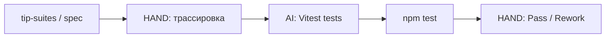

# Урок 2.2 — Unit-тесты: от tip-suites к Vitest

| | |
|---|---|
| **Неделя** | 2 |
| **Время** | 70–90 минут |
| **Сдача** | `weeks/02/submissions/lesson-02.md` |
| **Проверка** | `проверь домашку недели 2, урок 2` |
| **Cursor сегодня** | Agent + `npm test`; чтение вывода Vitest |
| **Нужно** | Готовый `projects/web-tip-calculator/` с урока 2.1 |

---

## Одна картина

Модуль 1: кейсы на бумаге (`tip-suites.md`).  
Модуль 2: **те же смыслы** → assert'ы в коде.



| Роль | Урок |
|------|------|
| QA | выбрать кейсы, принять покрытие |
| AI | написать тесты в `calc.test.ts` |
| AQA | `npm test` локально |

---

## Минимум теории

**Unit** здесь — только `src/lib/calc.ts`: чистые функции, без DOM.

| Тип из модуля 1 | Пример для calc |
|-----------------|-----------------|
| functional | bill=100, tip=10 → total=110 |
| boundary | tip=0, tip=30 |
| negative | tip=-1, tip=31, split=0, split=21 |

Один тест ≠ один кейс на бумаге: можно parametrized test, но **трассировка** в сдаче обязательна.

---

## Cursor сегодня

### Allowlist

```text
projects/web-tip-calculator/**
weeks/02/submissions/lesson-02.md
```

### Команды

```bash
cd projects/web-tip-calculator
npm install -D vitest
npm test          # после настройки script "test"
```

Agent должен добавить в `package.json`: `"test": "vitest run"`.

**Ты** смотришь вывод: какой assert упал, какая строка — это feedback loop до CI.

---

## Задание Agent (MIX)

```text
Фаза: +tests (scaffold-web-tip-calculator).

Контекст: @weeks/01/practice/tip-suites.md @weeks/02/spec/tip-calculator.md
Проект: projects/web-tip-calculator/

Добавь Vitest:
- devDependency vitest
- script "test": "vitest run"
- src/lib/calc.test.ts

Покрой минимум:
- functional: bill=100 tip=10 split=1
- boundary: tip=0, tip=30
- negative: validateInput для tip=31 и split=0 (или эквивалент)

Allowlist: только projects/web-tip-calculator/

DoD:
1. npm test → exit 0
2. ≥6 test cases
3. Тесты только calc/validateInput, без React render
```

Или skill:

```text
scaffold-web-tip-calculator, фаза +tests
```

---

## Домашнее задание

| Часть | Метка | Что |
|-------|-------|-----|
| **A** | HAND | Таблица трассировки ≥6 строк: Case ID / Requirement → test name в calc.test.ts |
| **B** | HAND | Скрин или paste вывода `npm test` (все green) |
| **C** | AI | Vitest + calc.test.ts в проекте |
| **D** | HAND | Self-check + 1 абзац: какой тип теста (neg/boundary) был сложнее автоматизировать |
| **E** | HAND | Commit hash + push в свой repo |

Файл: `weeks/02/submissions/lesson-02.md`

---

## DoD

[`../rubrics/lesson-02.md`](../rubrics/lesson-02.md)

---

## Сдача

`проверь домашку недели 2, урок 2`

---

## Отложено

CI, Playwright, student rule — уроки 2.3–2.4.
