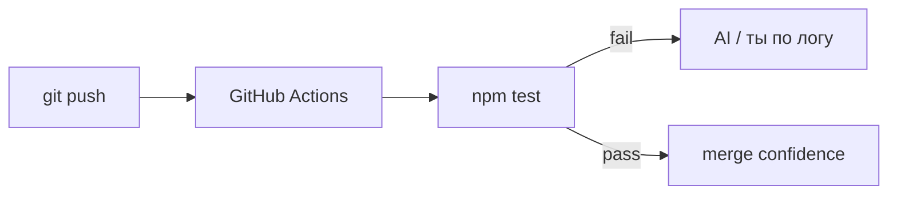

# Урок 2.3 — GitHub Actions + первый rule в student harness

| | |
|---|---|
| **Неделя** | 2 |
| **Время** | 60–80 минут |
| **Сдача** | `weeks/02/submissions/lesson-03.md` |
| **Проверка** | `проверь домашку недели 2, урок 3` |
| **Cursor сегодня** | workflow YAML; badge/status в GitHub UI |
| **Нужно** | Урок 2.2: зелёный `npm test` локально |

---

## Одна картина

Локальный `npm test` — ты нажал кнопку.  
**CI** — судья, который работает без твоей памяти «я же проверял».



Это начало **AI self-check**: агент не «готов», пока CI красный.

---

## Минимум теории

Workflow лежит в workbook:

```text
.github/workflows/web-tip-calculator.yml
```

Триггер: `push` и `pull_request` на ветку `main` (или твою default).

Job: checkout → setup-node → npm ci → npm test **в каталоге проекта**.

---

## Cursor сегодня

Allowlist:

```text
.github/workflows/**
projects/web-tip-calculator/**
student/rules/web-testing.mdc
weeks/02/submissions/lesson-03.md
```

После push: GitHub → Actions → смотри лог упавшего job.

---

## Задание 1 — CI (AI)

```text
Создай .github/workflows/web-tip-calculator.yml:
- on: push, pull_request (main)
- job: ubuntu-latest, node 20
- working-directory: projects/web-tip-calculator
- steps: checkout, setup-node, npm ci, npm test

DoD: файл валидный YAML; README проекта — строка «CI: см. Actions»
```

---

## Задание 2 — Student rule (MIX)

Первый файл **твоего** portable-харнеса:

**`student/rules/web-testing.mdc`**

| Поле | Содержание (HAND набросок → AI оформи) |
|------|----------------------------------------|
| description | когда применять (web, tip calculator, тесты) |
| alwaysApply | false |
| Тело | 5–7 буллетов: unit перед UI; npm test обязателен; DoD включает CI green; не коммить без test script |

**HAND:** смысл правил своими словами в сдаче.  
**AI:** оформление `.mdc` по образцу `course-workspace.mdc`.

---

## Домашнее задание

| Часть | Метка | Что |
|-------|-------|-----|
| **A** | HAND | Ссылка на успешный (или failing→fixed) run Actions + что было в логе |
| **B** | AI | workflow file |
| **C** | MIX | `student/rules/web-testing.mdc` |
| **D** | HAND | Self-check; commit + push |
| **E** | HAND | 3 предложения: чем CI лучше «я локально гонял» |

---

## DoD

[`../rubrics/lesson-03.md`](../rubrics/lesson-03.md)

---

## Сдача

`проверь домашку недели 2, урок 3`

---

## Отложено

Playwright, skill run-and-fix — урок 2.4.
