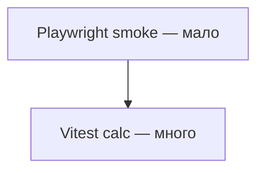

# Урок 2.4 — Playwright smoke + skill run-and-fix

| | |
|---|---|
| **Неделя** | 2 |
| **Время** | 80–100 минут |
| **Сдача** | `weeks/02/submissions/lesson-04.md` |
| **Проверка** | `проверь домашку недели 2, урок 4` |
| **Cursor сегодня** | Playwright; skill в `student/skills/` |
| **Нужно** | 2.2–2.3: unit + CI |

---

## Одна картина

Пирамида на Tip Calculator:



Unit ловит математику. E2E ловит «кнопки живы, total на экране».

---

## Минимум теории

| | Unit | E2E |
|---|------|-----|
| Скорость | быстро | медленнее |
| Стабильность | выше | flake возможен |
| Этот урок | уже есть | 1–2 smoke сценария |

Smoke e2e пример: открыть `/`, ввести bill/tip/split, увидеть Total 110.00.

---

## Задание 1 — Playwright (AI)

Allowlist: `projects/web-tip-calculator/**`

```text
Добавь Playwright:
- @playwright/test, config
- script "test:e2e": "playwright test"
- e2e/smoke.spec.ts — один happy path (100, 10, 1 → total visible)

DoD:
1. npm run test:e2e локально green (или document if env block)
2. Не ломать npm test unit
3. Обнови CI workflow: job или step для e2e (опционально, если тяжело — заметка в README)
```

---

## Задание 2 — Student skill run-and-fix (MIX)

**`student/skills/run-and-fix/SKILL.md`**

Skill для цикла:

1. `npm test` (и при возможности e2e)  
2. если fail — прочитать лог  
3. править **только** allowlist проекта  
4. повторить до green  

**HAND:** в сдаче — промпт, которым вызовешь skill после **намеренного** слома (например tip formula +1).  
**AI:** тело skill.  
**HAND:** опиши 1 итерацию fix по логу.

---

## Домашнее задание

| Часть | Метка | Что |
|-------|-------|-----|
| **A** | HAND | Таблица: сломал что → какой тест упал → что исправил |
| **B** | AI | Playwright smoke + skill run-and-fix |
| **C** | HAND | Self-check; commit push |
| **D** | HAND | Мета: unit vs e2e — что бы оставил только ручным |

---

## DoD

[`../rubrics/lesson-04.md`](../rubrics/lesson-04.md)

После Pass → [`../CHECKPOINT.md`](../CHECKPOINT.md)

---

## Сдача

`проверь домашку недели 2, урок 4`
